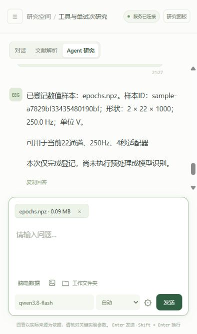
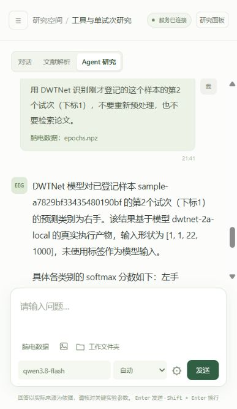

# EEG 智库 Agent

面向脑电（EEG）研究的知识库与智能工作台。项目将文献导入、可追溯检索问答和受控的 EEG 分析工具结合，帮助研究者整理资料、查阅实验设置与理解已有分析结果。

## 界面预览

以下截图来自 2026 年 11 月 12 日的界面验收，展示移动端视图和示例数据；功能是否可用取决于本地配置与模型文件。

**脑电数据登记**：在研究对话中登记样本，并查看数据形状、采样率与适配情况。



**Agent 研究**：基于已登记的样本执行模型分析并查看结果。



**预处理 Skills**：查看模型对应的预处理能力与适用条件。


## 功能

- **资料导入**：支持 PDF、DOCX 和 Markdown，保留原件，解析并切分内容，建立可检索索引；PDF 解析可配置 MinerU。
- **知识问答**：结合向量检索、HyDE、RRF 融合与可选重排，组织证据并展示来源。
- **研究 Agent**：通过任务规划与工具调用处理研究问题，支持任务状态、过程和结果查看。
- **EEG 工具**：提供单试次数据与模型相关分析能力，具体可用性依赖本地样本、权重及运行环境；特征提取结果不等同于临床诊断或自动分类结论。
- **研究空间**：支持账号、会话、模型连接以及资料管理。

## 架构

```text
浏览器工作台
  ├─ 资料导入 API → 解析 / 切分 → Embedding → Milvus
  │                         └─ 原件与图片 → MinIO
  └─ 查询与 Agent API → 检索 / 融合 / 重排 → 证据回答与工具执行
                            └─ MongoDB：历史与任务状态
```

主要技术包括 Python、FastAPI、LangGraph、Milvus、MongoDB、MinIO、BGE 和 MNE。实际启用的模型和服务取决于配置。

## 本地运行

需要 Python 3.11 或更高版本，以及可访问的 Milvus、MongoDB、MinIO、模型服务和相应模型文件。依赖体积较大，模型和数据不包含在仓库中。

```powershell
# 在仓库目录执行；需预先安装 uv
uv sync
Copy-Item .env.example .env
# 编辑 .env，填写模型服务地址、密钥和数据库连接
.venv\Scripts\python.exe -m uvicorn app.api.http.import_server:app --host 127.0.0.1 --port 8000
# 另开一个终端
.venv\Scripts\python.exe -m uvicorn app.api.http.query_server:app --host 127.0.0.1 --port 8001
```

打开 `http://127.0.0.1:8001/html` 进入研究工作台，`http://127.0.0.1:8000/html` 进入资料导入。首次使用需要完成账号设置。模型下载、服务连接、MinerU 等需按 `.env.example` 和实际环境配置；仅启动页面不代表所有检索或分析能力均已就绪。

可选的运动想象预处理依赖及使用说明见 [docs/mi-preprocessing.md](docs/mi-preprocessing.md)。本仓库不包含原项目机器专用的 Hyper-V 配置、数据卷或数据库。

## 目录

```text
app/api/        HTTP API 与请求模型
app/agent/      Agent 编排、工具和 EEG 技能
app/process/    导入和查询流程
app/rag/        文档处理、检索和回答服务
app/resources/  页面与提示词
app/workspace/  研究空间与连接管理
tests/          离线回归测试
docs/           使用说明与界面截图
```

本项目用于研究与工程探索，不作为医疗诊断依据。
